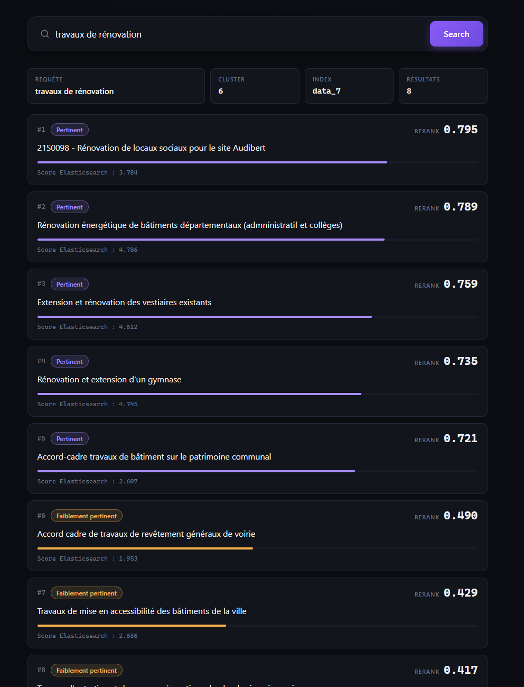
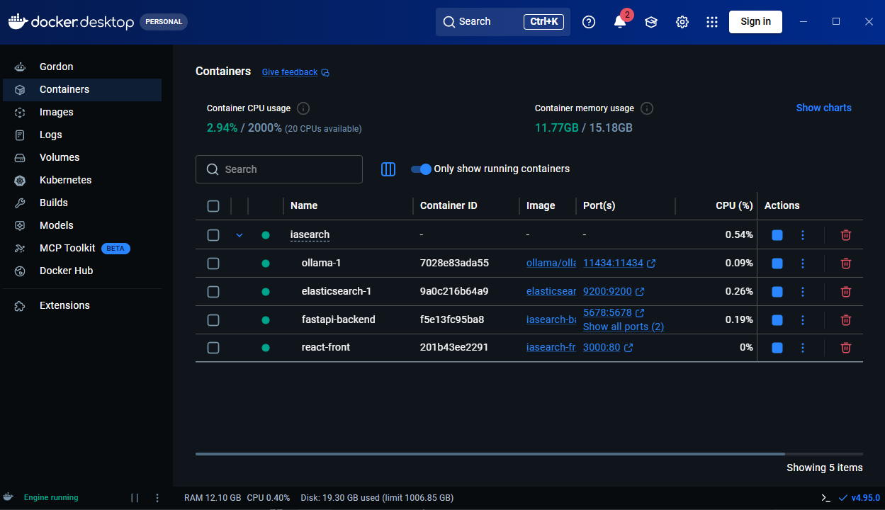
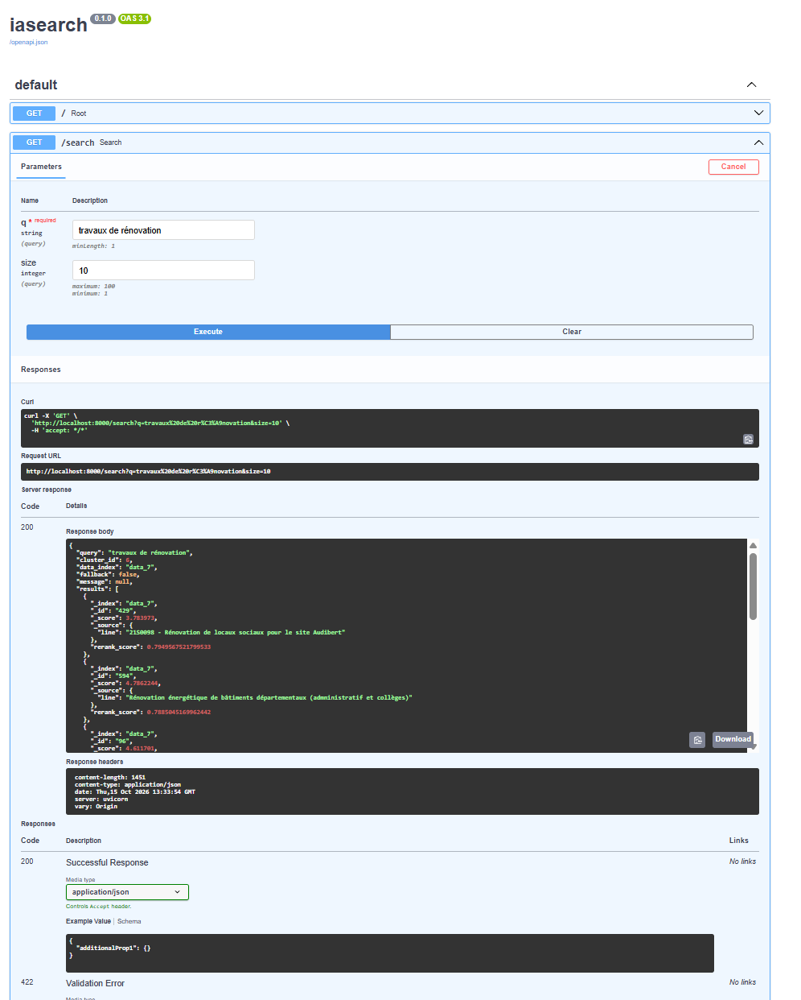

# IA Search

> Projet pédagogique réalisé dans le cadre du cours **Architecture IA** à l'**EPSI**.

IA Search est un moteur de recherche local qui combine **embeddings**, **clustering**, **recherche hybride Elasticsearch** et **reranking par LLM**. L'objectif du projet est de construire une chaîne de recherche IA complète, de l'indexation des données jusqu'à l'affichage des résultats dans une interface web.

## Aperçu

### Recherche pertinente



### Requête hors sujet et fallback

Lorsque la requête ne correspond pas suffisamment aux données disponibles, l'application le signale et affiche malgré tout les trois candidats les plus proches.


## Architecture

```text
INDEXATION

Données pCloud
      |
      v
qwen3-embedding:0.6b
      |
      v
KMeans - 10 clusters
      |
      +------------------------+
      |                        |
      v                        v
Elasticsearch             cluster_centers
(data_1 ... data_10)


RECHERCHE

Utilisateur
    |
    v
React / Nginx
    |
    v
FastAPI
    |
    v
qwen3-embedding:0.6b
    |
    v
KNN sur cluster_centers
    |
    v
Recherche hybride BM25 + KNN dans data_X
    |
    v
qwen3.5:0.8b - rerank yes/no + logprobs
    |
    v
Seuil 0.4
    |
    +--> résultats pertinents
    |
    +--> aucun résultat pertinent : fallback Top 3
    |
    v
React / Nginx
```

L'ensemble des services applicatifs est exécuté localement avec Docker Compose.



## Stack technique

| Composant | Technologie | Rôle |
|---|---|---|
| Frontend | React + TypeScript + Vite | Interface de recherche et affichage des scores |
| Reverse proxy | Nginx | Sert le front et transmet `/api/*` au backend |
| Backend | FastAPI | Orchestration de la recherche |
| Moteur de recherche | Elasticsearch 9.3.2 | KNN, BM25 et stockage des embeddings |
| Modèles locaux | Ollama | Embeddings et reranking |
| Embedding | `qwen3-embedding:0.6b` | Vectorisation des textes et des requêtes |
| Reranker | `qwen3.5:0.8b` | Évaluation finale de la pertinence |
| Clustering | scikit-learn / KMeans | Répartition des données en 10 clusters |
| Déploiement | Docker Compose | Exécution locale des services |

## Fonctionnement

### 1. Indexation

Le script `index_data/main.py` :

1. récupère le jeu de données depuis pCloud ;
2. calcule les embeddings par lots avec Ollama ;
3. applique un KMeans en **10 clusters** ;
4. crée les index Elasticsearch `data_1` à `data_10` ;
5. indexe chaque document avec son texte et son embedding ;
6. stocke les centres des clusters dans `cluster_centers`.

### 2. Recherche

Lors d'une requête utilisateur :

1. la requête est transformée en embedding ;
2. un KNN sur `cluster_centers` sélectionne le cluster le plus proche ;
3. une recherche **hybride BM25 + KNN** est exécutée dans l'index `data_X` correspondant ;
4. les candidats sont envoyés au reranker local ;
5. les résultats sont triés par `rerank_score` puis filtrés par pertinence.

### 3. Reranking

Le reranker utilise `qwen3.5:0.8b` avec une sortie contrainte :

```json
{"answer": "yes"}
```

ou

```json
{"answer": "no"}
```

Les `logprobs` des variantes `yes/no` sont converties en probabilités puis combinées avec :

```text
rerank_score = p_yes / (p_yes + p_no)
```

Les documents sont traités en parallèle avec `asyncio` / `httpx`.

Le seuil de pertinence est fixé à **0.4** :

- si des documents dépassent le seuil, seuls ces résultats sont affichés ;
- si aucun document ne dépasse le seuil, l'API passe en mode `fallback` et renvoie malgré tout les **3 meilleurs candidats**, accompagnés d'un avertissement.

## API

FastAPI expose les endpoints suivants :

| Endpoint | Description |
|---|---|
| `GET /` | Vérification simple de l'API |
| `GET /search?q=...&size=10` | Recherche complète avec sélection automatique du cluster |
| `GET /search/{cluster_id}?q=...&size=10` | Recherche dans un cluster imposé (`0` à `9`) |
| `GET /docs` | Documentation Swagger interactive |

La réponse principale contient notamment :

```json
{
  "query": "travaux de rénovation",
  "cluster_id": 6,
  "data_index": "data_7",
  "fallback": false,
  "message": null,
  "results": []
}
```

Chaque résultat conserve le `_score` Elasticsearch et ajoute un `rerank_score` utilisé pour le classement final.

### Swagger



## Installation et lancement

### Prérequis

- Git
- Docker Desktop / Docker Compose
- support GPU NVIDIA pour Docker recommandé (`gpus: all` est activé pour Ollama)
- `uv` pour exécuter le script d'indexation

### 1. Cloner le projet

```bash
git clone https://github.com/DuwezN/iasearch.git
cd iasearch
```

### 2. Démarrer Elasticsearch et Ollama

```bash
docker compose up -d elasticsearch ollama
```

### 3. Télécharger les modèles Ollama

```bash
docker compose exec ollama ollama pull qwen3-embedding:0.6b
docker compose exec ollama ollama pull qwen3.5:0.8b
```

### 4. Indexer les données

```bash
cd index_data
uv sync
uv run python main.py
cd ..
```

> L'indexation est une étape initiale séparée du lancement de l'application. Elle nécessite Elasticsearch et Ollama déjà démarrés.

### 5. Construire et démarrer l'application

```bash
docker compose up -d --build
```

Services accessibles :

- Front : `http://localhost:3000`
- API : `http://localhost:8000`
- Swagger : `http://localhost:8000/docs`
- Elasticsearch : `http://localhost:9200`
- Ollama : `http://localhost:11434`

La première requête peut être plus lente, le temps qu'Ollama charge le modèle de reranking en mémoire.

## Structure du dépôt

```text
iasearch/
├── docker-compose.yml
├── docs/
│   └── images/
├── fastapi-backend/
│   ├── Dockerfile
│   ├── main.py
│   ├── rerank.py
│   ├── pyproject.toml
│   └── uv.lock
├── index_data/
│   ├── main.py
│   ├── pyproject.toml
│   └── uv.lock
└── react-front/
    ├── Dockerfile
    ├── nginx.conf
    ├── src/
    │   ├── App.tsx
    │   └── App.css
    └── package.json
```

## Exemples de comportement

### Requête pertinente

`travaux de rénovation`

Le moteur sélectionne le cluster correspondant, effectue la recherche hybride puis affiche les résultats classés par `rerank_score` avec leur niveau de pertinence.

### Requête hors sujet

`recette de gâteau au chocolat`

Si aucun candidat n'atteint le seuil de `0.4`, l'interface indique que la recherche ne correspond pas suffisamment aux données disponibles et affiche les trois résultats les plus proches avec leurs faibles scores de rerank.

## Limites connues

- La recherche commence par sélectionner **un seul cluster**. Un document pertinent situé dans un autre cluster peut donc ne pas être considéré.
- `qwen3.5:0.8b` est un petit modèle local : le reranking peut encore produire des faux positifs ou faux négatifs.
- L'indexation est actuellement lancée séparément et n'est pas automatisée dans Docker Compose.
- Elasticsearch est configuré sans authentification pour ce projet local et pédagogique ; cette configuration n'est pas destinée à la production.

## Contexte pédagogique

Ce dépôt a été développé dans le cadre du cours **Architecture IA** à l'EPSI. Il sert à expérimenter une architecture de recherche IA locale comprenant l'indexation vectorielle, le clustering, la recherche hybride, le reranking par LLM, une API FastAPI et un frontend React conteneurisé.

## Auteur

**Nicolas Duwez**
